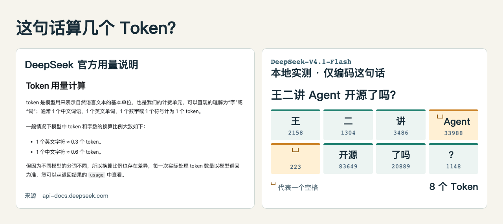

# wanger-image

把技术文章里的 `【截图：……】` 变成读者真正需要的图。**wanger-image** 是沉默王二的中文文章配图 Skill，可以在 Codex 里引用官方截图、捕获本地实测结果、生成手绘原理图，也可以把需要看过程的段落做成循环 GIF。

默认使用**二哥手绘风**。白板、能力卡、数据看板、三层架构、泳道和清单卡是六种排版；PNG 或循环 GIF 是输出格式。只需说「替换这篇文章的截图占位符」。Skill 会结合每处占位符和相邻段落选材：要核对 Token ID 就放静态对照图，要看字节到齐后才显示汉字的过程就做成 GIF。

## 分词器文章的三种配图

| 手绘静态图 | 真实截图与本地实测 |
| --- | --- |
|  |  |
| 对照同一个词：「人工智能」占 12 个 UTF-8 字节，在这版分词器里只占 1 个 Token。 | 对照来源和结果：「王二讲 Agent 开源了吗？」在本地编码为 8 个 Token，两个空格也能逐个核对。 |

**机制 GIF**　沿橙色回路看一次预测：模型选出一个 Token，把它接回上下文，再预测下一个。


[看完整 Case](examples/tokenizer/README.md) · [配图前的 Markdown](examples/tokenizer/before.md) · [替换后的文章](examples/tokenizer/after.md)

## 在 Codex 里试一次

```bash
git clone https://github.com/itwanger/wanger-image.git
cd wanger-image
cp examples/tokenizer/before.md examples/tokenizer/my-article.md
codex
```

在 Codex 输入下面这句话。桌面版也可以直接打开这个仓库，在新对话里输入同样的指令。

```text
使用 $wanger-image 替换 examples/tokenizer/my-article.md 的四处占位符。
按同目录 assets.json 的映射复用现成素材，使用本地相对路径，只改占位符。
```

打开 `my-article.md` 就能看到两张 PNG 和两张 GIF。仓库已经通过 `.agents/skills/wanger-image` 暴露了 Skill。这个例子用现成素材，无需配置图床。也可以[用一条 Python 命令离线复现](examples/tokenizer/README.md#离线复现回填)。

## 给自己的文章配图

要在多个项目里使用，在克隆后的仓库根目录执行一次。若目标已经存在，先确认它是否已指向这份仓库。

```bash
mkdir -p ~/.agents/skills
ln -s "$PWD/skills/wanger-image" ~/.agents/skills/wanger-image
```

只想在某个项目使用，可以将 `skills/wanger-image/` 整个复制到目标项目的 `.agents/skills/wanger-image/`。回到文章所在项目，新开 Codex 对话，输入 `$wanger-image` 并给出 Markdown 路径。显式使用 Skill 和本地发现路径可查 [Codex 官方说明](https://learn.chatgpt.com/docs/build-skills)。

正文中把占位符放在独立的一行。例如：

```markdown
【截图：分词器编码与解码；截图目标：画出输入编码和下一 Token 预测循环；关键词：Token ID、嵌入向量、解码】
```

```text
使用 $wanger-image 替换 docs/tokenizer.md 里的截图占位符。
把图放在文章旁的 images/，用相对链接回填。
```

| 文章里要说明的事 | 产出 | 需要什么 |
| --- | --- | --- |
| 官方文档原话、真实产品界面 | 页面或元素截图 | 能访问原页面的浏览器 |
| 程序如何响应一次操作 | 实测截图或真实状态 GIF | 可运行的 Case 和帧捕获工具 |
| 结构、异同、数字对照 | 中文手绘图解 | 可用的图像生成工具；随包提供 6 种排版、9 张基础版式参考 |
| 循环、分支、状态变化 | 手绘机制 GIF | 手绘底图；内置渲染器使用 macOS、Swift、FFmpeg 和 Python 3 |

默认用本地相对路径。需要发布到自己的图床时，可以使用随包的 [阿里云 OSS 上传说明](skills/wanger-image/references/oss.md)。算法测量、在线截图和图像生成各有自己的依赖，单纯复用已有成品只需 Python 3。

## 许可

项目原创代码、说明和配图采用 [MIT 许可证](LICENSE)。Case 截图中引用的 DeepSeek 官方页面内容归原权利人所有，原始页面与测量依据列在 [Case 来源](examples/tokenizer/README.md#复核数据和动画)。
