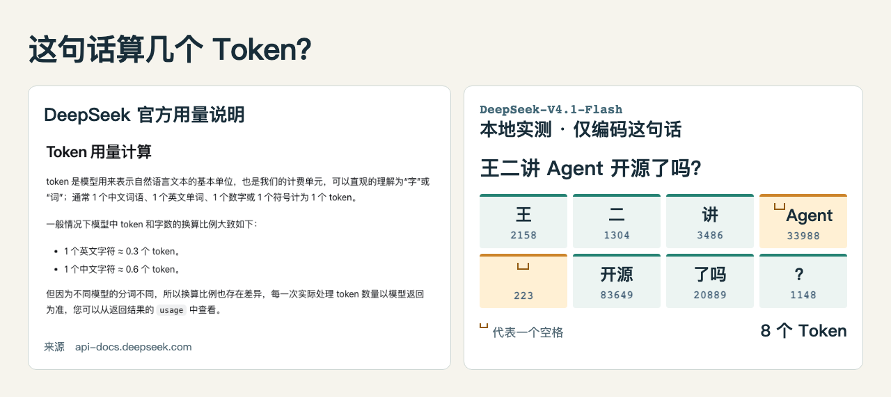
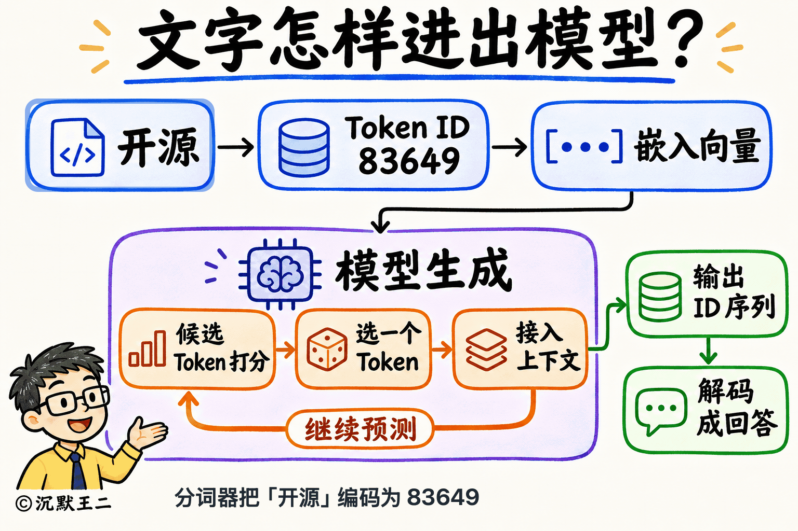
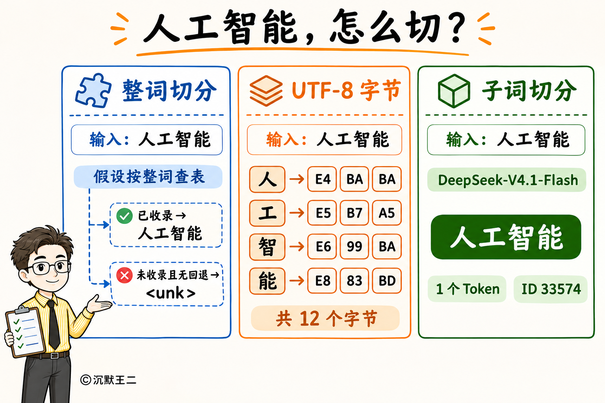
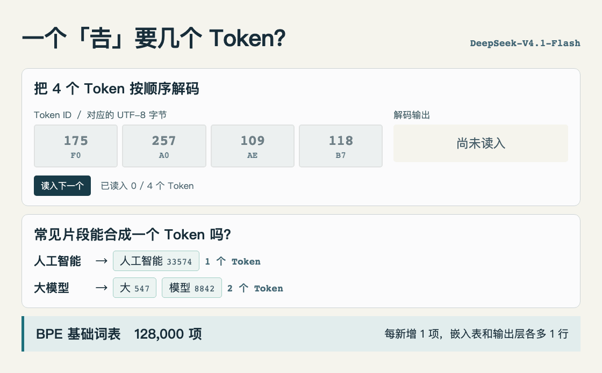

# DeepSeek 用了什么分词器？

「王二讲 Agent 开源了吗？」单独交给 DeepSeek-V4.1-Flash 的分词器，会得到 8 个 Token。Agent 前面的空格和单词合在一起，后面的空格自己占一个 Token。

分词器把文字编码为 ID。比如「开源」的 ID 是 83649。模型读取对应的嵌入向量，给候选 Token 打分，选出的 Token 接回上下文，开始下一轮预测。输出的 ID 序列可以再解码为文字。

同样是「人工智能」，按 UTF-8 拆开有 12 个字节，用这版分词器编码却只有 1 个 Token。

「𠮷」被编码成 4 个 Token。依次读入对应的字节，直到第四个字节到达，流式 UTF-8 解码器才能显示完整的字。

